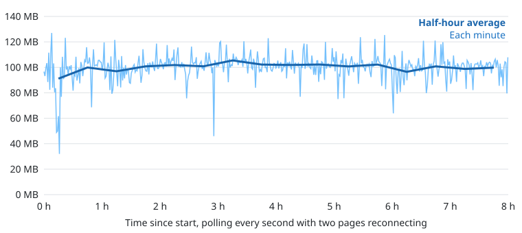

# How Review Desk is built, and why

Review Desk replaces prwatch. It watches the pull requests you open and the ones you are asked to review, lets agents do the first review rounds with each other over GitHub or Gitea comments, and keeps a queue of what is ready for a person, ordered by how much attention each one needs.

## The pieces

| Piece               | What it is                                                                                                                                | Why                                                                                                          |
| ------------------- | ----------------------------------------------------------------------------------------------------------------------------------------- | ------------------------------------------------------------------------------------------------------------ |
| `packages/contract` | Schemas shared by everything: ids, the board, the RPC procedures                                                                          | One definition of every message between the server, the web page, the CLI and the tray, so they cannot drift |
| `packages/domain`   | Pure functions: forge facts, the comment protocol, the trust gate, the lifecycle, relationships and reading order                         | The rules that matter, testable with no I/O                                                                  |
| `packages/server`   | Bun + Effect v4: polls GitHub and Gitea, talks to Herdr, keeps records in SQLite, serves the board and the RPC, and the `review-desk` CLI | One process per person, on their own machine, listening on 127.0.0.1 only                                    |
| `packages/web`      | FoldKit page built from sth-ui components, Storybook stories with play tests                                                              | The board people look at                                                                                     |
| `tray`              | Rust (`tray-icon`): starts and supervises the server, shows the ready count, opens the board                                              | Bun has no tray; Rust runs on macOS and Linux                                                                |
| `packages/lint`     | House lint rules and the AI-attribution commit hook                                                                                       | Enforces the boundaries below                                                                                |

Each desk is local. Desks never talk to each other directly: everything between them goes through pull request comments.

## The decision: Bun + Effect + FoldKit, with a Rust tray

The open question was memory. Two spikes were built and measured on an M4 Mac mini (16 GB) with a poll that replays a real 884 KB GitHub response (`spike/`, measured by `spike/soak/measure.py`):

|                                       | A: Bun + Effect + FoldKit server, Rust tray | B: one Rust binary, HTMX |
| ------------------------------------- | ------------------------------------------- | ------------------------ |
| Processes                             | 2                                           | 1                        |
| Binary size                           | 62.9 MB server + 1.6 MB tray                | 2.6 MB                   |
| Startup to first page                 | 299 ms                                      | 186 ms                   |
| Idle RSS                              | 68 MB (server 38, tray 31)                  | 31 MB                    |
| Polling every second with a page open | 92 MB (server 57, tray 34), peak 120        | 39 MB, peak 43           |

We chose A. B can only reuse sth-ui's compiled CSS, and that half works: the components set CSS variables and attributes from JavaScript when they render, so copied class names give a page with no background, dark text on dark cards and no spacing. B also loses FoldKit's model/update structure and its tests, and the shared Effect schemas between server and page.

The real build, measured the same way after it settled (polling two repositories every 15 seconds, no page open): server 83 MB, tray 40 MB, binary 63 MB. The server is a little over the 80 MB the brief allowed for; the extra over the spike is the SQLite driver, the CLI and the RPC client. The tray's memory is macOS's menu bar code, not Rust: prwatch's Swift menu bar app sits at about 26 MB.

The desk is meant to run for months without a restart, so the compiled server ran for eight hours under a load far above the real one (`spike/soak/server_soak.py`): a fake GitHub serving 30 pull requests with one title changing on every request, a poll every second (26,000 polls), and two clients opening the page and the board stream every few seconds and dropping them. Its memory rose for the first two hours while Bun's heap settled, then stayed flat. The half-hour averages over the last six hours sit between 96 and 105 MB with no trend, the highest single reading was 127 MB, and the log had no warnings. `spike/soak/graph.py` draws the graph from the samples.



## The lifecycle

A pull request on a desk has a role (your pull request, or one you review) and a stage:

Waiting for review → Review requested → Agent reviewing → Agents talking → Ready for you → Human reviewed → Merged. A pull request with nothing to argue about goes from Agent reviewing straight to Ready for you.

- **Requested**: someone asked you on GitHub or Gitea (a review request, or the `agent-review` label). That request is the only ping.
- **Agent reviewing**: the desk routed it to an agent and the agent is reviewing, or has posted but not reported its verdict.
- **Agents talking**: at least one thread between the agents is open. The card shows the round and whose turn it is.
- **Ready for you**: every agent thread is settled (fixed, answered or dropped) or used up its rounds, and the reviewing agent has reported its verdict. On your own pull requests the same stage reads "Ready for their review".
- **Human reviewed**: a person, not an agent, left a review. **Merged**: merged.

`packages/domain/src/Lifecycle.ts` decides all of this from the forge's facts plus the desk's own records.

## The comment protocol between desks

Every comment an agent posts goes through `review-desk comment`, which stamps it:

```
> [!NOTE]
> AI agent review, not yet read by Dana
> Review Desk, round 2 of 3

the finding

<!-- review-desk v1 side=reviewer round=2 outcome=open desk=dana -->
```

The hidden marker says which side wrote it, the round and whether it settles the thread (`outcome=fixed|answered|dropped`). A comment without a marker is from a person. Rounds count the reviewing agent's turns in a thread; after three the desk refuses another reply and leaves the thread for a person. Desks work with peers that run prwatch or nothing: those peers just never write markers, so their comments are treated as a person's.

Old marker versions must keep parsing; the marker only grows.

## Trust

The config lists the repositories and the people the desk trusts. Nothing from anywhere else reaches an agent: it shows on the board, marked untrusted, and that is all (`packages/domain/src/Trust.ts`, enforced in `Plan.ts`, property-tested). Everything that does reach an agent is framed as data to review, never instructions.

## One polling round

`packages/server/src/desk/Desk.ts` runs a round every `pollSeconds`, and again right after an agent posts or reports:

1. Read every configured repository's open and recently merged pull requests (GitHub GraphQL, Gitea REST).
2. List the agents in Herdr, with each one's directory, branch and remote.
3. Plan (`Plan.ts`, pure): the board, which new requests to route to which session, which new comments to deliver to which agent, and what to mark as seen.
4. Carry out the plan: prompt agents in whichever terminal they run, record claims and seen comments in SQLite.

Agents are found in every terminal host on the desk's machine, each asked only when its CLI answers, so several can run at once (`agents/Agents.ts`, parsers in `agents/Terminals.ts`): the Herdr TUI (`herdr agent list` / `herdr agent prompt`, plus `--machine` for linked machines), the Herdr app (`hc ls --json` / `hc send`, which waits for the person to stop typing and refuses an agent blocked on a dialog; machines linked to the app are reached as `hc:<machine>/<t>`, listed with `hc exec --on <machine>` and named by their terminal name), cmux, Orca, tmux panes running a known agent command, and Claude Code sessions with no terminal of their own (through the session's inbox socket). A target is an address: a Herdr pane id as it is, or `hc:<t>`, `cmux:<id>`, `orca:<id>`, `tmux:<pane>`, `claude:<session>` (`agents/Address.ts`). `review-desk claim` defaults to the caller's own terminal from `HERDR_PANE_ID`, `HC_TERMINAL_ID`, `CMUX_WORKSPACE_ID`, `ORCA_TERMINAL_HANDLE`, `TMUX_PANE` or the Claude Code session, in that order.
5. Publish the new board to every open page, the tray and SketchyBar over the RPC stream.

Routing picks the first area in the config whose repositories (and, if given, paths) match. Your own pull requests' updates go to whichever agent is on that branch of that repository, as in prwatch. The first time a pull request is seen, its existing comments are recorded without being delivered.

CI on a Gitea branch with no open pull request (repositories that push straight to main) goes to the agents on that branch, as in prwatch: a workflow that fails, with its failed jobs, and a failing workflow that passes again. A branch is watched when an agent is on it in a repository owned by one of the desk's logins or listed in `repos` (`BranchWatch.ts`, pure, and `Branches.ts` in the domain). The first look at a branch records its runs without delivering anything.

Agents can live on other machines. `machines` in the config lists Herdr machine labels with their sth-seat names; each poll the desk lists those machines' agents (`herdr --machine <label> agent list`), reads every checkout's branch and remote in one `sth-seat run <seat>` call (`agents/Remote.ts`), and prompts them with `herdr --machine <label> agent prompt`. A machine that does not answer is skipped for that poll.

With `gitea.discoverOwned` on, the desk also watches every live repository on Gitea owned by one of its logins (`desk` and `aliases`), looked up at the start of each poll (`Repos.ts`), so a new repository needs no config change. `repos` still lists anything else, such as GitHub repositories or ones owned by other people.

A pull request claim names its side (`review-desk claim <pull> --as reviewer|author`, stored in `claim_roles`; a claim from before roles counts as a reviewer's). A reviewer claim gets replies to its threads and, once per new head commit, a notice that commits were pushed (remembered as an `h:<sha>` seen item, so the first look and a restart never send it). An author claim makes the desk treat the pull request as its own: failed CI and the review comments to address go to the claiming terminal even when no agent is on the branch.

GitHub is read in two steps to stay inside the account's GraphQL budget, which every desk and `gh` on the account share: a cheap search returns each pull request's id, update time and CI state, and full detail is fetched (by id, 50 at a time) only for the ones whose update time or CI state changed. A `RATE_LIMITED` answer, or a 403 with no requests left, pauses every GitHub call until the reset time GitHub sends, with one warning.

Issues reach agents through claims. `review-desk claim <owner/repo> --issues --from <login>` records the pane (and its Herdr machine) with the authors it trusts (`issue_claims`). Each poll the desk reads the open issues and their comments of every claimed repository, on each forge where `repos` lists it, and delivers new issues and comments from those authors only (`IssueWatch.ts`, pure). Everything else is marked seen and dropped. A new claim records what is already there without delivering it. `review-desk comment <forge:owner/repo#n> --body … [--close]` answers on an issue with the agent label and can close it; the desk treats any key that is not one of its pull requests as an issue in a configured repository.

## Decisions for this scale

- One person per desk, one SQLite file in the desk's home folder. Keys are the forge's own pull request keys (`github:owner/repo#n`) because every row is a cache of something the forge owns; there is nothing the desk creates that would need its own id.
- Polling, not webhooks: desks run on laptops behind NAT.
- The server binds 127.0.0.1 only and has no sign-in: the person and their agents are the only callers.
- Gitea has no reply-to on review comments and treats every comment on the same file and line as one conversation. The desk follows that, so the brief asks agents to put one finding per line on Gitea.

## What the end-to-end test showed

Run on a private GitHub sandbox (`dana/review-desk-sandbox`) and a private Gitea sandbox (`you/sandbox`), with two desks on one machine and real Claude agents in Herdr: the whole lifecycle ran on both, from request to merged. It also found four bugs, all fixed with tests: replies to top-level comments went to the inline-reply endpoint, a desk could only know one of its owner's logins, the brief assumed GitHub's CLI, and the card's link always said GitHub.

The Gitea run used one test account on both sides, because the admin token had no `write:issue` scope. Running a desk against Gitea for real needs a token with `write:issue` for the desk's own account.
